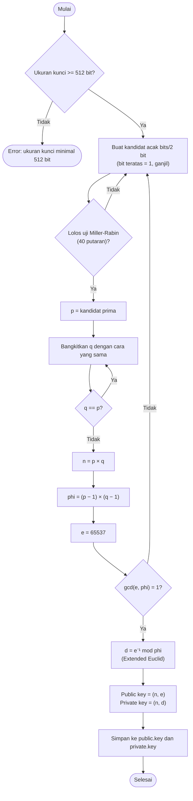
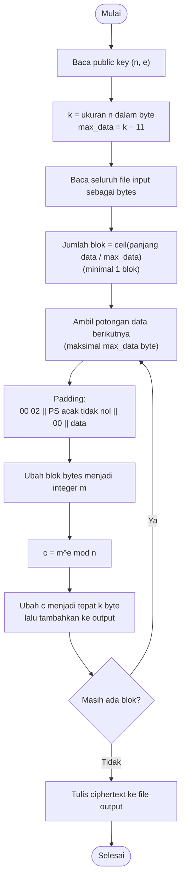
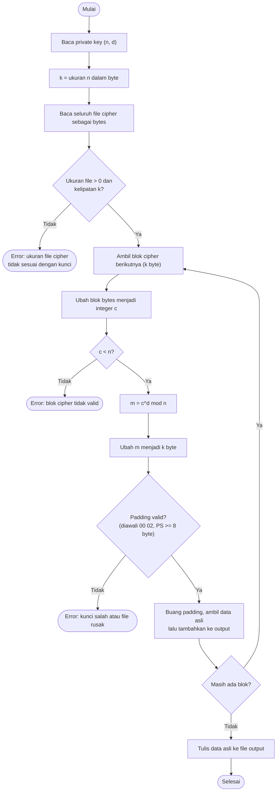

# RSA File Encryption & Decryption

## Deskripsi

Program ini dibuat untuk mempelajari proses enkripsi dan dekripsi file
menggunakan algoritma RSA. Perhitungan RSA dibuat secara manual pada
`rsa_file_crypto.py`, mulai dari pembangkitan bilangan prima, pembentukan
kunci, padding, sampai proses enkripsi dan dekripsi.

Repository ini memiliki dua cara penggunaan:

- versi web melalui Flask;
- versi terminal melalui `rsa_file_crypto.py`.

Keduanya menggunakan fungsi RSA yang sama. Versi web hanya menambahkan
antarmuka browser melalui `app.py`.

## Anggota Tim

| No. | Nama | NRP |
|---|---|---|
| 1 | Kanafira Vanesha Putri | 5027241010 |
| 2 | Fika Arka Nuriyah | 5027241071 |
| 3 | S. Farhan Baig | 5027241097 |

## Versi Web

Versi web dapat digunakan untuk:

- membuat pasangan public key dan private key;
- mengenkripsi dan mendekripsi file;
- memasukkan file melalui upload;
- memasukkan pesan melalui paste text;
- memasukkan key melalui upload atau paste text;
- menyalin ciphertext text dalam format Base64.

### Menjalankan

```bash
chmod +x run.sh
./run.sh
```

Setelah server berjalan, buka `http://127.0.0.1:5000` pada browser. Script
tersebut akan menyiapkan virtual environment dan dependency yang diperlukan.

Jika ingin menjalankan server secara langsung:

```bash
python app.py
```

Port dapat diubah, misalnya dengan `RSA_PORT=5050 ./run.sh`.

### Alur penggunaan

1. Buat key pair atau masukkan key yang sudah ada.
2. Pilih Encrypt atau Decrypt.
3. Pilih upload file atau paste text.
4. Masukkan public key untuk enkripsi dan private key untuk dekripsi.
5. Jalankan proses, kemudian download atau salin hasilnya.

## Versi Terminal

Versi terminal tetap tersedia pada `rsa_file_crypto.py` dan dapat dijalankan
tanpa server web:

```bash
python rsa_file_crypto.py
```

atau:

```bash
python3 rsa_file_crypto.py
```

Menu program:

```text
1. Bangkitkan kunci (public.key & private.key)
2. Enkripsi file
3. Dekripsi file
0. Keluar
```

File `public.key` digunakan saat enkripsi, sedangkan `private.key` digunakan
saat dekripsi. Contoh file input tersedia pada
[`contoh_input.txt`](./contoh_input.txt).

Format key yang digunakan adalah dua angka desimal:

- `public.key`: `n` lalu `e`;
- `private.key`: `n` lalu `d`.

## Alur Kerja RSA

Flowchart berikut menggambarkan proses pada `rsa_file_crypto.py`.

### Pembuatan kunci

Fungsi `generate_keys()` dan `generate_prime()`:



### Enkripsi

Fungsi `encrypt_file()` menggunakan public key `(n, e)`:



### Dekripsi

Fungsi `decrypt_file()` menggunakan private key `(n, d)`:



## Struktur Proyek

```text
.
├── app.py
├── rsa_file_crypto.py
├── templates/index.html
├── static/app.js
├── static/styles.css
├── tests/test_app.py
├── contoh_input.txt
├── requirements.txt
├── run.sh
├── README.md
└── PENJELASAN_RSA.md
```

`rsa_file_crypto.py` berisi algoritma RSA dan menu terminal. `app.py` berisi
backend Flask yang memanggil fungsi dari file tersebut. Folder `templates`
dan `static` digunakan untuk tampilan web.

## Pengujian

```bash
python -m unittest discover -s tests -v
```

Pengujian mencakup enkripsi-dekripsi file biner, enkripsi-dekripsi text,
penggunaan key dalam bentuk text, key yang salah, dan token download yang
tidak valid.

## Catatan

Program ini dibuat untuk keperluan akademik. Implementasi RSA dan padding-nya
ditulis sendiri, sehingga belum ditujukan untuk melindungi data penting pada
lingkungan produksi. Private key juga harus disimpan dengan baik dan tidak
dibagikan.

Laporan proyek tersedia pada
[`Laporan Program RSA-Based Secure File Encryption & Decryption - Lengkap.pdf`](./Laporan%20Program%20RSA-Based%20Secure%20File%20Encryption%20%26%20Decryption%20-%20Lengkap.pdf).
